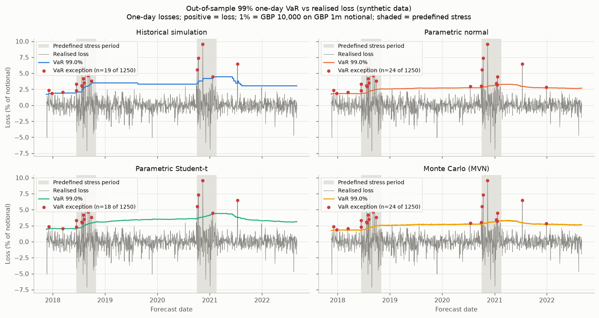
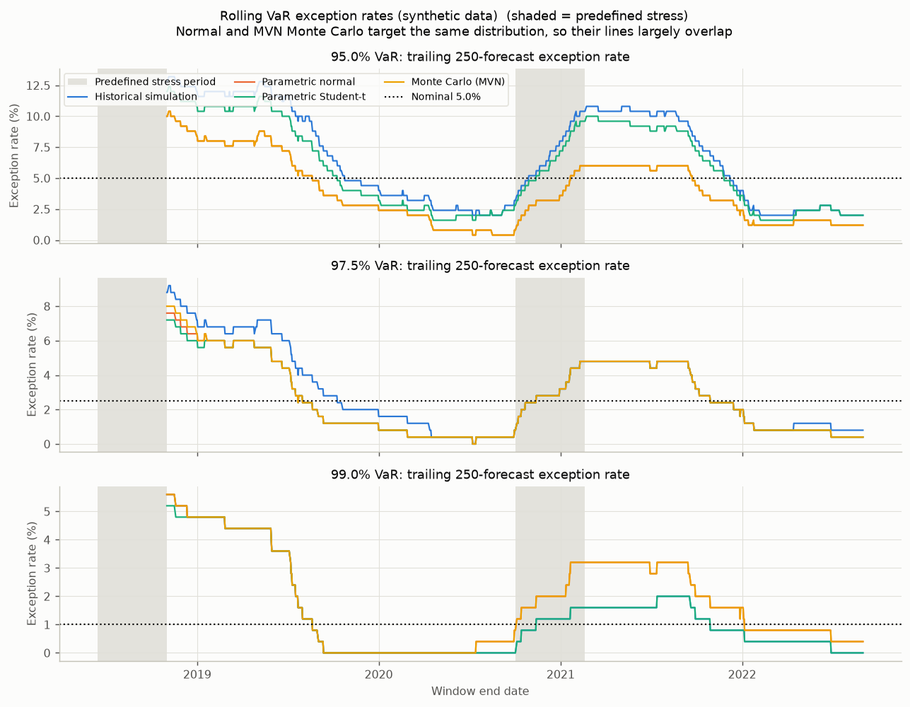
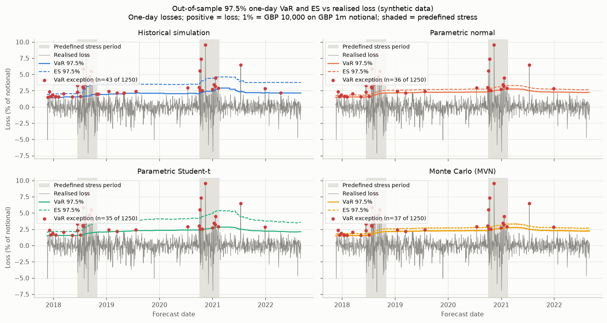
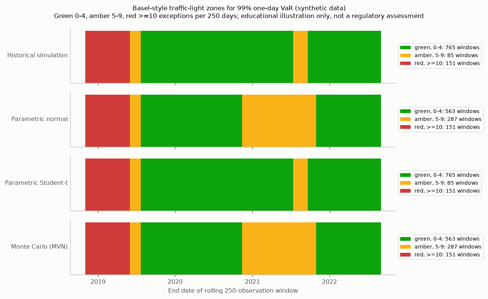
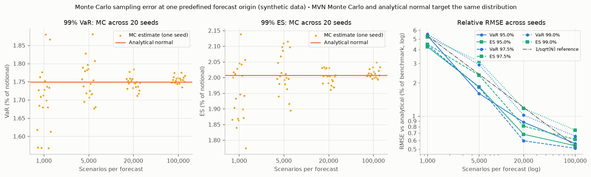

# VaR and ES Estimation and Backtesting (`var-es-backtesting`)

This is a reproducible Python engine that estimates and evaluates **one-day Value at Risk
(VaR) and Expected Shortfall (ES)** for a five-asset, long-only equity portfolio. It uses
strictly out-of-sample rolling forecasts.

**Research question.** How do historical simulation, parametric normal, parametric
Student-t and correlated multivariate-normal Monte Carlo compare when forecasting one-day
portfolio VaR and ES?

**Status.**
* The code, tests, synthetic baseline run, figures, generated report and documentation
  are complete. The final test run gave 127 passed, 0 failed, 0 skipped.
* All results in this repository come from **synthetic data**. They are not evidence
  about real markets.
* This is a research and learning project. It is not production risk software and makes
  no regulatory-compliance claim.

This is a code-and-results project. It has no web app, dashboard or database.

## Methods
| Component | Implementation |
|---|---|
| Portfolio | Fixed weights 0.30/0.25/0.20/0.15/0.10, daily rebalanced, decimal simple returns, `loss = -return`, GBP 1,000,000 constant reporting notional |
| Historical simulation | Empirical VaR/ES of the trailing 750 losses |
| Parametric normal | Sample mean and SD (ddof=1) |
| Parametric Student-t | Constrained MLE (ν ∈ [2.01, 1000]) with closed-form VaR/ES |
| Monte Carlo | Correlated MVN asset returns (mean and covariance from the window), 20,000 scenarios, date-derived `SeedSequence` seeds |
| Forecasting | Rolling 750-day window, refit daily, data through *t−1* only; 95% / 97.5% / 99% |
| VaR tests | Kupiec POF, Christoffersen independence and conditional coverage (LR, χ²) |
| ES evaluation | FZ0 joint VaR/ES score (Patton, Ziegel & Chen 2019) and the ES identification residual (descriptive) |
| Traffic lights | Educational Basel-style zones for 99% VaR over 250 consecutive days |
| Stress | Two predefined synthetic stress intervals, compared with non-stress days |

Full formulas and conventions are in [docs/methodology.md](docs/methodology.md).

### VaR versus ES evaluation
* **VaR** gets formal coverage and independence tests.
* **ES** gets a joint VaR/ES scoring rule (FZ0) and calibration diagnostics in this
  version. No formal ES hypothesis test is claimed.
* ES is not a quantile, so ES is never assessed by counting how often losses exceed it.

### Empirical convention
* VaR is the ⌈n·c⌉-th smallest loss.
* ES is the mean of the worst (1−c) probability mass, with fractional weight on the
  boundary observation.
* An exception means a loss *strictly greater* than VaR.

## Quick start

### Windows PowerShell
```powershell
py -3.14 -m venv .venv          # requires Python >= 3.11; only 3.14.4 has been tested
.\.venv\Scripts\Activate.ps1
python -m pip install -e ".[dev]"
python scripts/generate_data.py --config configs/synthetic_baseline.json
python scripts/run_backtest.py --config configs/synthetic_baseline.json
python scripts/run_mc_convergence.py --config configs/synthetic_baseline.json
python scripts/generate_report.py --results-dir results/synthetic_baseline
python -m pytest -q
```

### macOS / Linux
```bash
python3 -m venv .venv
source .venv/bin/activate
python -m pip install -e ".[dev]"
python scripts/generate_data.py --config configs/synthetic_baseline.json
python scripts/run_backtest.py --config configs/synthetic_baseline.json
python scripts/run_mc_convergence.py --config configs/synthetic_baseline.json
python scripts/generate_report.py --results-dir results/synthetic_baseline
python -m pytest -q
```

**Notes**
* Run the commands from the project root. Every script has `--help`.
* Paths containing spaces work.
* For exact versions, run `python -m pip install -r requirements-lock.txt` first.
* The full baseline forecasting step took about 15 s on the development machine.
* A quick pipeline check uses `configs/smoke_test.json`, a small configuration labelled
  as a smoke test, which writes to `results/smoke_test/`.

### Your own data
Use `configs/user_data_example.json` and see [data/user/README.md](data/user/README.md).
* **Input mode:** you must choose `input_mode: "returns"` or `"prices"`. It is never
  inferred.
* **Missing values:** handled by complete-case exclusion, with the excluded dates
  reported. Nothing is forward-filled.
* **Downloads:** no market data is downloaded.

## Results (synthetic baseline)
* 2,000 synthetic observations (seed 42), 1,250 out-of-sample forecast dates, 4 models
  and 3 confidence levels.
* No fit failures. Stress intervals are observation indices 900–999 and 1500–1599.
* Full tables are in [results/synthetic_baseline/research_report.md](results/synthetic_baseline/research_report.md).
* The interpretation is in [docs/results.md](docs/results.md).

| Model | Conf. | N | Exceptions | Expected | Kupiec p | CC p | Mean VaR (GBP) | Mean ES (GBP) | Mean FZ0 |
|---|---|---|---|---|---|---|---|---|---|
| Historical simulation | 95% | 1,250 | 82 | 62.5 | 0.0155 | 0.0514 | 15,611 | 26,241 | −3.4717 |
| Historical simulation | 97.5% | 1,250 | 43 | 31.2 | 0.0438 | 0.1200 | 20,741 | 34,956 | −3.1429 |
| Historical simulation | 99% | 1,250 | 19 | 12.5 | 0.0861 | 0.0225 | 32,140 | 49,799 | −2.6990 |
| Parametric normal | 95% | 1,250 | 52 | 62.5 | 0.1610 | 0.1877 | 18,446 | 23,171 | −3.4526 |
| Parametric normal | 97.5% | 1,250 | 36 | 31.2 | 0.4006 | 0.4817 | 22,009 | 26,281 | −3.0761 |
| Parametric normal | 99% | 1,250 | 24 | 12.5 | 0.0037 | 0.0033 | 26,151 | 29,983 | −2.3349 |
| Parametric Student-t | 95% | 1,250 | 74 | 62.5 | 0.1465 | 0.2567 | 15,840 | 28,135 | −3.4895 |
| Parametric Student-t | 97.5% | 1,250 | 35 | 31.2 | 0.5049 | 0.5171 | 22,015 | 37,807 | −3.1685 |
| Parametric Student-t | 99% | 1,250 | 18 | 12.5 | 0.1424 | 0.0274 | 32,727 | 55,095 | −2.6974 |
| Monte Carlo (MVN) | 95% | 1,250 | 52 | 62.5 | 0.1610 | 0.1877 | 18,439 | 23,164 | −3.4516 |
| Monte Carlo (MVN) | 97.5% | 1,250 | 37 | 31.2 | 0.3112 | 0.4339 | 21,996 | 26,276 | −3.0750 |
| Monte Carlo (MVN) | 99% | 1,250 | 24 | 12.5 | 0.0037 | 0.0033 | 26,138 | 29,979 | −2.3256 |

These observations hold for this one synthetic path only:
* **Normal and Monte Carlo agree**, as theory predicts for a linear portfolio. Both have
  about twice the nominal number of 99% exceptions, and both are rejected by Kupiec at 99%.
* **Mean FZ0 scores.** Student-t has the lowest (best) score at 95% and 97.5%. At 99%,
  Student-t and historical simulation are essentially tied. Differences were not tested
  for significance.
* **Conditional coverage fails at 99% for every model.** Exceptions cluster in the
  predefined stress windows, which rolling unconditional models do not adapt to quickly.







The report also includes portfolio returns, correlations, the return distribution, 95%
VaR and stress-period detail charts. They are in `results/synthetic_baseline/figures/`.

## Tests
```bash
python -m pytest -q
python -m pytest -q --junitxml=results/synthetic_baseline/test_results.xml   # as saved
```

The suite has 127 tests:
* unit tests for every module;
* independent numerical checks by integration and hand calculation;
* no-look-ahead tests;
* two end-to-end command-line runs.

See [docs/validation.md](docs/validation.md).

## Folder structure
```
configs/        synthetic_baseline.json, user_data_example.json, smoke_test.json
data/           synthetic/ (generated CSVs + metadata), user/ (your data; README only)
src/var_es/     validation, data, synthetic, portfolio, empirical, historical, parametric,
                monte_carlo, forecasting, backtesting, es_evaluation, traffic_light,
                metrics, plotting, reporting
scripts/        generate_data, run_backtest, run_mc_convergence, generate_report
tests/          pytest suite (10 test modules + conftest)
docs/           methodology, data_dictionary, results, validation, learning_guide, references
results/        synthetic_baseline/ (CSV, JSON, XML, report, figures/)
```
The code keeps modelling (`empirical`, `historical`, `parametric`, `monte_carlo`),
backtesting (`backtesting`, `es_evaluation`, `traffic_light`, `metrics`), file writing
(`scripts/`) and plotting (`plotting`) separate.

## Synthetic-data disclaimer
* The dataset is generated offline from a stylised process: correlated Gaussian latent
  log returns, a shared truncated scale mixture for heavy tails, and predefined
  volatility regimes, converted to simple returns with `expm1`.
* It is a controlled test bed and not a model of any real market.
* Findings here must not be read as evidence that any method is better on real equity
  data.

## Traffic-light scope
* The green (0–4), amber (5–9) and red (≥10) zones apply only to 99% one-day VaR over
  250 consecutive valid observations. They follow the zone boundaries of the 1996 Basel
  Committee backtesting framework.
* They are shown for **education** only. They are not p-values and are not applied to
  ES or other confidence levels.
* No capital multiplier is calculated, and no regulatory approval or compliance is
  implied.

## Limitations
* All models are unconditional rolling-window models with no GARCH/filtered historical
  simulation (FHS), which is out of scope. That explains exception clustering in stress.
* There is one synthetic path and no seed-to-seed uncertainty analysis.
* No significance test is run on score differences.
* VaR tests use asymptotic χ² distributions, which ignore estimation error and window
  overlap. Power at 99% is low.
* ES has a joint score and descriptive diagnostics, not a formal backtest.
* Out of scope: options, nonlinear instruments, multi-day horizons, intraday data,
  trading strategies, transaction costs and capital calculations.
* The normal and Monte Carlo models allow simple returns below −100%; draws are not
  clipped (none occurred in the baseline).

## Documentation
[Methodology](docs/methodology.md) · [Data dictionary](docs/data_dictionary.md) ·
[Results](docs/results.md) · [Validation](docs/validation.md) ·
[Learning guide](docs/learning_guide.md) · [References](docs/references.md)

## Licence
MIT. See [LICENSE](LICENSE).
