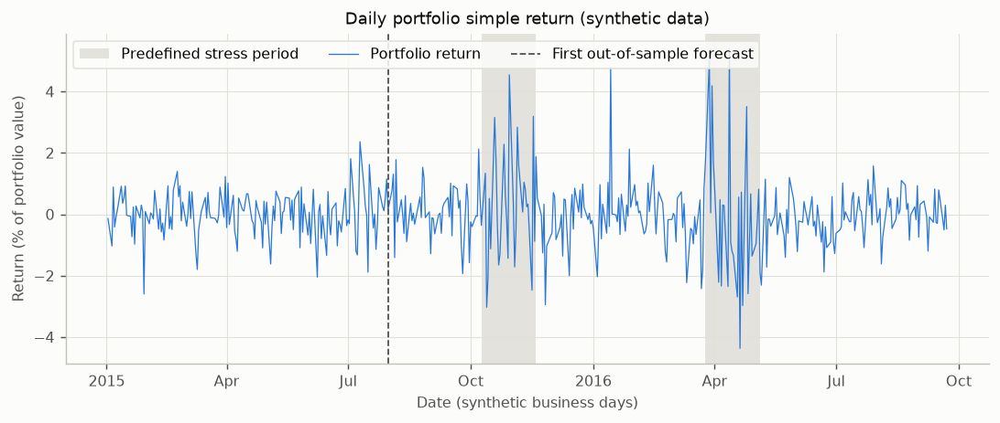
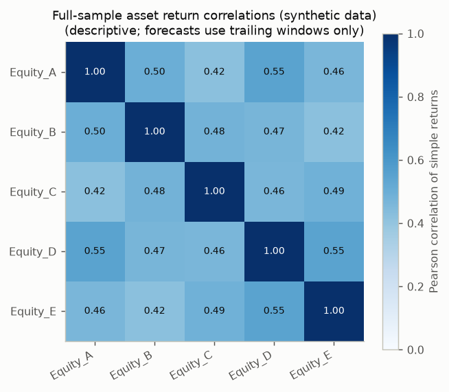
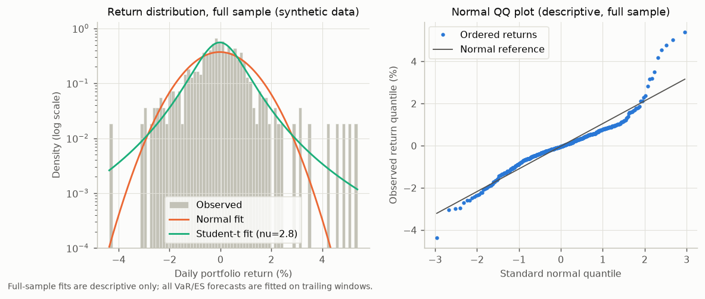
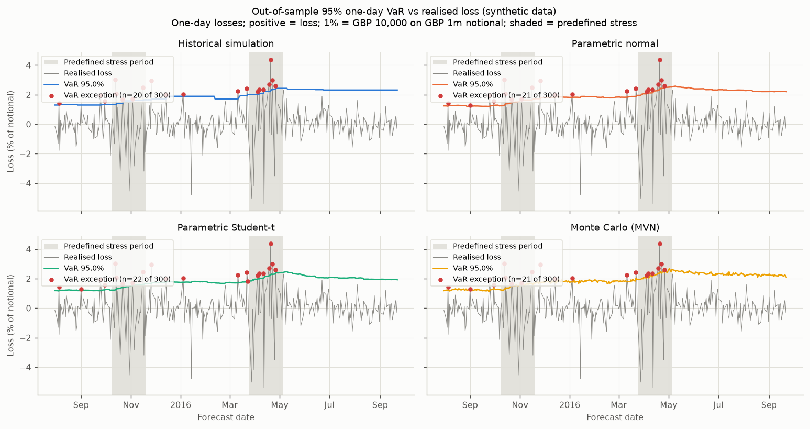
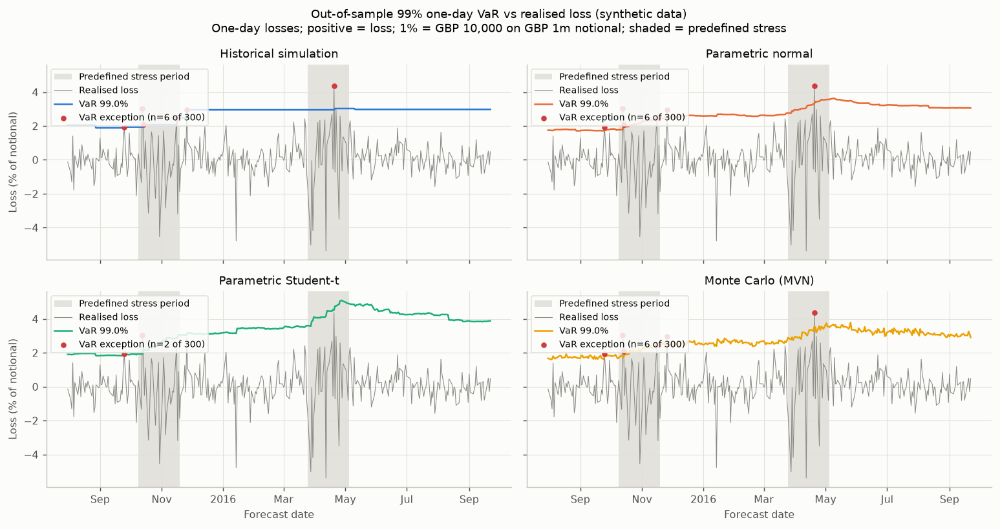
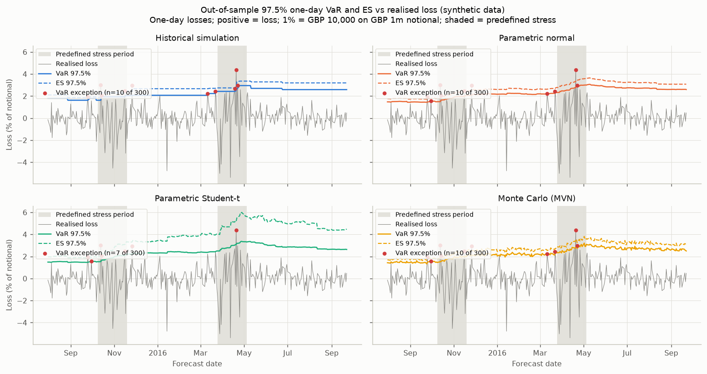
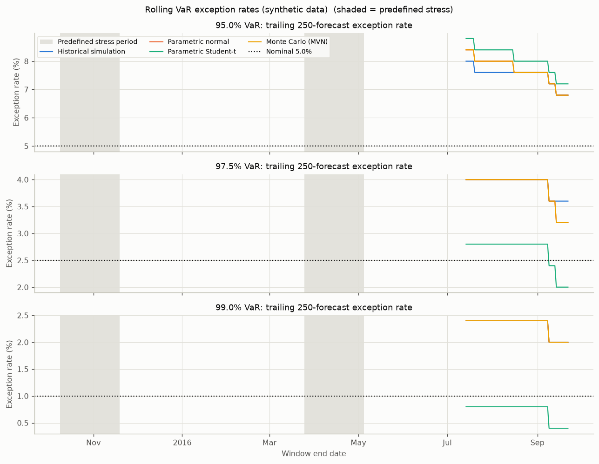
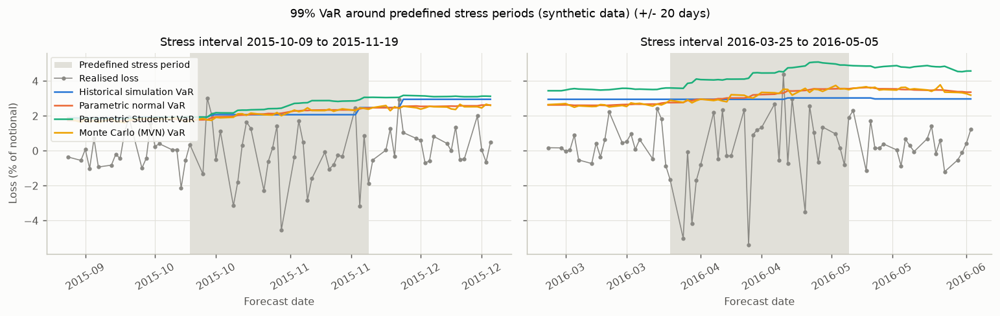
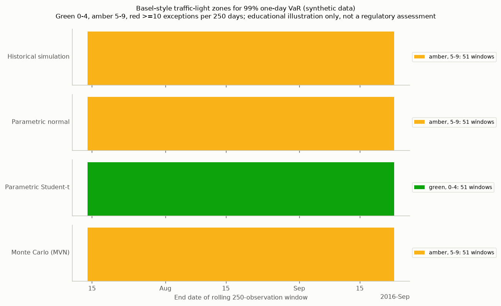
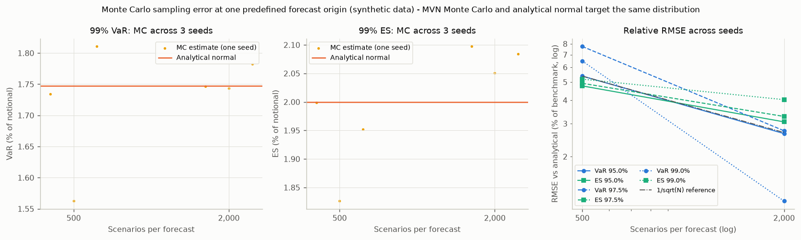

# Research report: smoke_test

*Generated from saved outputs in this folder. Backtest executed (UTC): 2026-11-15T11:17:19Z. Report generated (UTC): 2026-11-15T11:17:25Z.*

> **All results below are computed on synthetic data.** They describe model behaviour under a known, stylised data-generating process and are not evidence about real equity markets.

## 1. Overview

Research question: how do historical simulation, parametric normal, parametric Student-t and correlated multivariate-normal Monte Carlo compare when forecasting one-day portfolio VaR and ES out of sample? VaR is assessed with formal coverage and independence tests; ES is assessed with the FZ0 joint VaR/ES score and descriptive calibration diagnostics (no formal ES hypothesis test).

## 2. Configuration

- Data source: `synthetic`; file `data/smoke_test/asset_returns.csv` (SHA-256 `aba95d0647a87701...`).
- Observations used: 450 (2015-01-02 to 2016-09-22); dates excluded by the complete-case policy: 0.
- Weights: Equity_A 0.30, Equity_B 0.25, Equity_C 0.20, Equity_D 0.15, Equity_E 0.10; long-only, daily rebalanced.
- Reporting notional: GBP 1,000,000 (constant-notional comparison).
- Rolling estimation window: 150 observations; refit at every origin; one-day horizon; confidence levels 95.0%, 97.5%, 99.0%.
- Monte Carlo: 2,000 scenarios per origin; master seed 20240917; per-origin seeds from SeedSequence(master, YYYYMMDD, model id).
- Forecast dates: 300 (2015-07-31 to 2016-09-22); common valid sample: 300 dates.
- Predefined stress intervals: 2015-10-09 to 2015-11-19; 2016-03-25 to 2016-05-05.

## 3. Methods (summary)

See `docs/methodology.md` for formulas. Historical simulation applies the empirical engine to the trailing window; the normal model uses the sample mean and SD (ddof=1); the Student-t model is a constrained MLE (nu in [2.01, upper bound]); Monte Carlo simulates correlated MVN asset returns from the window's mean vector and covariance. For a linear portfolio, MVN Monte Carlo and the analytical normal model target the same distribution, so their differences are sampling error.

## 4. Results

### 4.1 VaR summary (common valid sample)

| Model | Conf. | N | Exceptions | Expected | Obs. rate | Nominal | Mean VaR (GBP) | Mean ES (GBP) | Mean quantile loss | Max run |
|---|---|---|---|---|---|---|---|---|---|---|
| Historical simulation | 95.0% | 300 | 20 | 15.0 | 0.0667 | 0.0500 | 19,144 | 23,818 | 1.333e-03 | 2 |
| Historical simulation | 97.5% | 300 | 10 | 7.5 | 0.0333 | 0.0250 | 22,431 | 27,251 | 7.589e-04 | 2 |
| Historical simulation | 99.0% | 300 | 6 | 3.0 | 0.0200 | 0.0100 | 27,048 | 31,608 | 3.832e-04 | 2 |
| Parametric normal | 95.0% | 300 | 21 | 15.0 | 0.0700 | 0.0500 | 19,065 | 23,892 | 1.318e-03 | 2 |
| Parametric normal | 97.5% | 300 | 10 | 7.5 | 0.0333 | 0.0250 | 22,705 | 27,069 | 7.560e-04 | 2 |
| Parametric normal | 99.0% | 300 | 6 | 3.0 | 0.0200 | 0.0100 | 26,937 | 30,851 | 3.766e-04 | 2 |
| Parametric Student-t | 95.0% | 300 | 22 | 15.0 | 0.0733 | 0.0500 | 17,822 | 29,567 | 1.308e-03 | 2 |
| Parametric Student-t | 97.5% | 300 | 7 | 7.5 | 0.0233 | 0.0250 | 24,041 | 38,649 | 7.572e-04 | 2 |
| Parametric Student-t | 99.0% | 300 | 2 | 3.0 | 0.0067 | 0.0100 | 34,381 | 54,327 | 3.807e-04 | 1 |
| Monte Carlo (MVN) | 95.0% | 300 | 21 | 15.0 | 0.0700 | 0.0500 | 19,019 | 23,841 | 1.311e-03 | 2 |
| Monte Carlo (MVN) | 97.5% | 300 | 10 | 7.5 | 0.0333 | 0.0250 | 22,601 | 27,003 | 7.534e-04 | 2 |
| Monte Carlo (MVN) | 99.0% | 300 | 6 | 3.0 | 0.0200 | 0.0100 | 26,820 | 30,755 | 3.744e-04 | 2 |

### 4.2 VaR coverage and independence tests

| Model | Conf. | Exc. | LR_uc | p_uc | n11 | LR_ind | p_ind | IND status | LR_cc | p_cc |
|---|---|---|---|---|---|---|---|---|---|---|
| Historical simulation | 95.0% | 20 | 1.596 | 0.2065 | 1 | 0.106 | 0.7446 | ok | 1.702 | 0.4271 |
| Historical simulation | 97.5% | 10 | 0.775 | 0.3787 | 1 | 0.955 | 0.3285 | ok | 1.730 | 0.4211 |
| Historical simulation | 99.0% | 6 | 2.348 | 0.1254 | 1 | 2.755 | 0.0970 | ok | 5.103 | 0.0780 |
| Parametric normal | 95.0% | 21 | 2.259 | 0.1328 | 1 | 0.196 | 0.6576 | ok | 2.455 | 0.2930 |
| Parametric normal | 97.5% | 10 | 0.775 | 0.3787 | 1 | 0.955 | 0.3285 | ok | 1.730 | 0.4211 |
| Parametric normal | 99.0% | 6 | 2.348 | 0.1254 | 1 | 2.755 | 0.0970 | ok | 5.103 | 0.0780 |
| Parametric Student-t | 95.0% | 22 | 3.025 | 0.0820 | 2 | 0.098 | 0.7538 | ok | 3.123 | 0.2098 |
| Parametric Student-t | 97.5% | 7 | 0.035 | 0.8517 | 1 | 2.161 | 0.1416 | ok | 2.196 | 0.3336 |
| Parametric Student-t | 99.0% | 2 | 0.382 | 0.5368 | 0 | 0.027 | 0.8696 | ok | 0.408 | 0.8153 |
| Monte Carlo (MVN) | 95.0% | 21 | 2.259 | 0.1328 | 1 | 0.196 | 0.6576 | ok | 2.455 | 0.2930 |
| Monte Carlo (MVN) | 97.5% | 10 | 0.775 | 0.3787 | 1 | 0.955 | 0.3285 | ok | 1.730 | 0.4211 |
| Monte Carlo (MVN) | 99.0% | 6 | 2.348 | 0.1254 | 1 | 2.755 | 0.0970 | ok | 5.103 | 0.0780 |

Automated reading at the 5% significance level (asymptotic chi-square p-values):

- Kupiec unconditional coverage: no rejection at the 5% level in 12 defined test(s).
- Christoffersen independence: no rejection at the 5% level in 12 defined test(s).
- Christoffersen conditional coverage: no rejection at the 5% level in 12 defined test(s).

Non-rejection does not prove a model correct; at 99% the expected exception count is small, so the tests have low power. Fewer exceptions than expected is not automatically better.

### 4.3 ES evaluation (joint score and descriptive diagnostics)

| Model | Conf. | FZ0 valid | FZ0 invalid | Mean FZ0 | Mean ES id. residual | SE (descr.) | Mean loss on exc. | Mean ES on exc. | Loss/ES ratio | ES<VaR |
|---|---|---|---|---|---|---|---|---|---|---|
| Historical simulation | 95.0% | 300 | 0 | -3.5871 | 3.12e-03 | 2.32e-03 | 0.0235 | 0.0222 | 1.060 | 0 |
| Historical simulation | 97.5% | 300 | 0 | -3.4473 | 3.38e-03 | 3.52e-03 | 0.0272 | 0.0249 | 1.089 | 0 |
| Historical simulation | 99.0% | 300 | 0 | -3.1533 | 6.98e-03 | 6.32e-03 | 0.0281 | 0.0254 | 1.103 | 0 |
| Parametric normal | 95.0% | 300 | 0 | -3.5989 | 2.75e-03 | 2.27e-03 | 0.0230 | 0.0222 | 1.037 | 0 |
| Parametric normal | 97.5% | 300 | 0 | -3.4516 | 3.44e-03 | 3.36e-03 | 0.0260 | 0.0242 | 1.078 | 0 |
| Parametric normal | 99.0% | 300 | 0 | -3.2004 | 7.09e-03 | 5.75e-03 | 0.0281 | 0.0259 | 1.083 | 0 |
| Parametric Student-t | 95.0% | 300 | 0 | -3.5952 | -3.14e-03 | 2.45e-03 | 0.0228 | 0.0275 | 0.830 | 0 |
| Parametric Student-t | 97.5% | 300 | 0 | -3.4220 | -8.09e-03 | 3.03e-03 | 0.0263 | 0.0279 | 0.941 | 0 |
| Parametric Student-t | 99.0% | 300 | 0 | -3.1664 | -1.60e-02 | 3.77e-03 | 0.0248 | 0.0233 | 1.065 | 0 |
| Monte Carlo (MVN) | 95.0% | 300 | 0 | -3.6109 | 2.64e-03 | 2.24e-03 | 0.0230 | 0.0221 | 1.040 | 0 |
| Monte Carlo (MVN) | 97.5% | 300 | 0 | -3.4626 | 3.40e-03 | 3.30e-03 | 0.0260 | 0.0241 | 1.080 | 0 |
| Monte Carlo (MVN) | 99.0% | 300 | 0 | -3.2008 | 6.95e-03 | 5.46e-03 | 0.0281 | 0.0262 | 1.072 | 0 |

Mean FZ0 score by confidence level, lowest (best) first. Differences have not been tested for statistical significance:

- 95.0%: Monte Carlo (MVN) (-3.6109) < Parametric normal (-3.5989) < Parametric Student-t (-3.5952) < Historical simulation (-3.5871)
- 97.5%: Monte Carlo (MVN) (-3.4626) < Parametric normal (-3.4516) < Historical simulation (-3.4473) < Parametric Student-t (-3.4220)
- 99.0%: Monte Carlo (MVN) (-3.2008) < Parametric normal (-3.2004) < Parametric Student-t (-3.1664) < Historical simulation (-3.1533)

The ES identification residual has mean zero for correctly specified continuous forecasts; positive values mean realised tail losses exceeded forecast ES on average. The SE column is a descriptive i.i.d. standard error and is not used for a formal test.

### 4.4 Stress versus non-stress periods

| Model | Conf. | Period | N | Exc. | Expected | Obs. rate | Mean VaR | Mean ES | Quantile loss | Mean FZ0 | Loss/ES on exc. |
|---|---|---|---|---|---|---|---|---|---|---|---|
| Historical simulation | 95.0% | stress | 60 | 12 | 3.0 | 0.2000 | 0.0187 | 0.0232 | 2.321e-03 | -2.7536 | 1.094 |
| Historical simulation | 95.0% | non_stress | 240 | 8 | 12.0 | 0.0333 | 0.0193 | 0.0240 | 1.087e-03 | -3.7955 | 1.003 |
| Historical simulation | 97.5% | stress | 60 | 6 | 1.5 | 0.1000 | 0.0226 | 0.0262 | 1.358e-03 | -2.5144 | 1.153 |
| Historical simulation | 97.5% | non_stress | 240 | 4 | 6.0 | 0.0167 | 0.0224 | 0.0275 | 6.092e-04 | -3.6806 | 0.989 |
| Historical simulation | 99.0% | stress | 60 | 4 | 0.6 | 0.0667 | 0.0254 | 0.0300 | 7.553e-04 | -1.7164 | 1.145 |
| Historical simulation | 99.0% | non_stress | 240 | 2 | 2.4 | 0.0083 | 0.0275 | 0.0320 | 2.901e-04 | -3.5125 | 1.010 |
| Parametric normal | 95.0% | stress | 60 | 12 | 3.0 | 0.2000 | 0.0189 | 0.0238 | 2.251e-03 | -2.8173 | 1.051 |
| Parametric normal | 95.0% | non_stress | 240 | 9 | 12.0 | 0.0375 | 0.0191 | 0.0239 | 1.085e-03 | -3.7943 | 1.015 |
| Parametric normal | 97.5% | stress | 60 | 5 | 1.5 | 0.0833 | 0.0226 | 0.0270 | 1.295e-03 | -2.5835 | 1.163 |
| Parametric normal | 97.5% | non_stress | 240 | 5 | 6.0 | 0.0208 | 0.0227 | 0.0271 | 6.214e-04 | -3.6686 | 0.982 |
| Parametric normal | 99.0% | stress | 60 | 4 | 0.6 | 0.0667 | 0.0269 | 0.0309 | 7.161e-04 | -1.9394 | 1.115 |
| Parametric normal | 99.0% | non_stress | 240 | 2 | 2.4 | 0.0083 | 0.0269 | 0.0308 | 2.918e-04 | -3.5156 | 1.013 |
| Parametric Student-t | 95.0% | stress | 60 | 12 | 3.0 | 0.2000 | 0.0181 | 0.0299 | 2.379e-03 | -2.8425 | 0.826 |
| Parametric Student-t | 95.0% | non_stress | 240 | 10 | 12.0 | 0.0417 | 0.0178 | 0.0295 | 1.040e-03 | -3.7833 | 0.837 |
| Parametric Student-t | 97.5% | stress | 60 | 4 | 1.5 | 0.0667 | 0.0244 | 0.0390 | 1.245e-03 | -2.7673 | 0.960 |
| Parametric Student-t | 97.5% | non_stress | 240 | 3 | 6.0 | 0.0125 | 0.0240 | 0.0386 | 6.353e-04 | -3.5856 | 0.908 |
| Parametric Student-t | 99.0% | stress | 60 | 1 | 0.6 | 0.0167 | 0.0348 | 0.0546 | 5.432e-04 | -2.5649 | 1.261 |
| Parametric Student-t | 99.0% | non_stress | 240 | 1 | 2.4 | 0.0042 | 0.0343 | 0.0543 | 3.401e-04 | -3.3168 | 0.856 |
| Monte Carlo (MVN) | 95.0% | stress | 60 | 12 | 3.0 | 0.2000 | 0.0189 | 0.0238 | 2.259e-03 | -2.8184 | 1.057 |
| Monte Carlo (MVN) | 95.0% | non_stress | 240 | 9 | 12.0 | 0.0375 | 0.0190 | 0.0238 | 1.073e-03 | -3.8091 | 1.012 |
| Monte Carlo (MVN) | 97.5% | stress | 60 | 5 | 1.5 | 0.0833 | 0.0225 | 0.0270 | 1.314e-03 | -2.5635 | 1.174 |
| Monte Carlo (MVN) | 97.5% | non_stress | 240 | 5 | 6.0 | 0.0208 | 0.0226 | 0.0270 | 6.132e-04 | -3.6873 | 0.975 |
| Monte Carlo (MVN) | 99.0% | stress | 60 | 4 | 0.6 | 0.0667 | 0.0268 | 0.0307 | 7.094e-04 | -1.9014 | 1.111 |
| Monte Carlo (MVN) | 99.0% | non_stress | 240 | 2 | 2.4 | 0.0083 | 0.0268 | 0.0308 | 2.906e-04 | -3.5257 | 0.987 |

Stress periods are short; rates and scores there are descriptive and no p-values are reported.

### 4.5 Basel-style traffic lights (99% VaR, educational)

| Model | Green windows | Amber windows | Red windows | Unavailable |
|---|---|---|---|---|
| Historical simulation | 0 | 51 | 0 | 0 |
| Monte Carlo (MVN) | 0 | 51 | 0 | 0 |
| Parametric normal | 0 | 51 | 0 | 0 |
| Parametric Student-t | 51 | 0 | 0 | 0 |

Zones count exceptions in overlapping 250-observation windows; they are not p-values, do not apply to ES or other confidence levels, and imply no regulatory approval or capital consequence.

### 4.6 Fit diagnostics and failures

- Historical simulation: ok = 300
- Monte Carlo (MVN): ok = 300
- Parametric normal: ok = 300
- Parametric Student-t: converged = 300
- Student-t nu: median 2.82, range 2.21 to 10.56; upper-bound hits 0, lower-bound hits 0.
- Monte Carlo covariance repairs: 0; simulated asset returns <= -100% (not clipped): 0.
- Invalid forecast rows excluded from the common sample: 0.

### 4.7 Monte Carlo convergence

Origin: forecast date 2015-07-31 (training 2015-01-02 to 2015-07-30); seeds: 3.

| Scenarios | Conf. | Seeds | Analytic VaR | Mean MC VaR | VaR RMSE | VaR mean |rel err| | Analytic ES | Mean MC ES | ES RMSE | ES mean |rel err| |
|---|---|---|---|---|---|---|---|---|---|---|
| 500 | 95.0% | 3 | 0.01241 | 0.01280 | 6.67e-04 | 0.0391 | 0.01551 | 0.01573 | 7.40e-04 | 0.0467 |
| 500 | 97.5% | 3 | 0.01475 | 0.01544 | 1.14e-03 | 0.0717 | 0.01756 | 0.01739 | 8.64e-04 | 0.0424 |
| 500 | 99.0% | 3 | 0.01747 | 0.01702 | 1.13e-03 | 0.0499 | 0.01999 | 0.01926 | 1.04e-03 | 0.0368 |
| 2,000 | 95.0% | 3 | 0.01241 | 0.01273 | 3.29e-04 | 0.0262 | 0.01551 | 0.01597 | 4.75e-04 | 0.0297 |
| 2,000 | 97.5% | 3 | 0.01475 | 0.01515 | 4.05e-04 | 0.0274 | 0.01756 | 0.01810 | 5.75e-04 | 0.0307 |
| 2,000 | 99.0% | 3 | 0.01747 | 0.01757 | 2.02e-04 | 0.0075 | 0.01999 | 0.02077 | 8.05e-04 | 0.0390 |

## 5. Figures

*Daily portfolio returns with predefined stress periods shaded.*

*Full-sample asset correlations (descriptive).*

*Full-sample return distribution with normal and Student-t fits (descriptive).*

*95% VaR forecasts against realised losses; exceptions marked.*

*99% VaR forecasts against realised losses; exceptions marked.*

*97.5% VaR and ES forecasts against realised losses.*

*Rolling exception rates against nominal rates.*

*99% VaR around the predefined stress periods.*

*Rolling 250-day traffic-light zones for 99% VaR (educational).*

*Monte Carlo convergence towards the analytical normal benchmark.*

## 6. Limitations

- Synthetic data: conclusions concern this stylised process only and do not establish real-market superiority.
- Unconditional rolling-window models: none of the models has conditional volatility dynamics; GARCH/FHS is out of scope.
- Overlapping estimation windows and estimation error mean the standard asymptotic test distributions are approximations.
- Low test power at 99% and in the short stress intervals.
- ES is evaluated by a joint score and descriptive diagnostics only; no formal ES backtest is implemented.
- Traffic lights are an educational simplification; no regulatory capital or compliance claim is made.
- The normal and Monte Carlo models can assign probability to returns below -100%; draws are not clipped.
