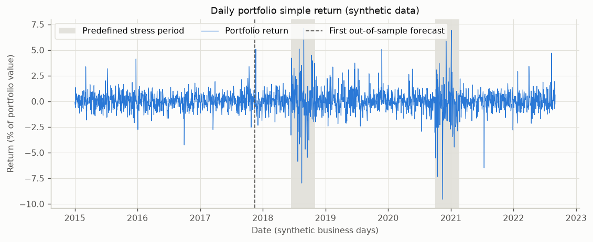
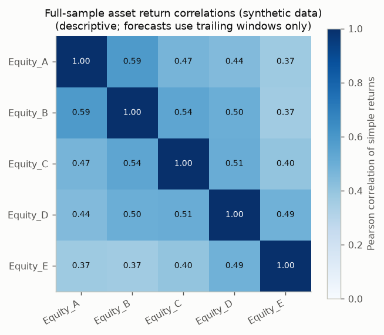
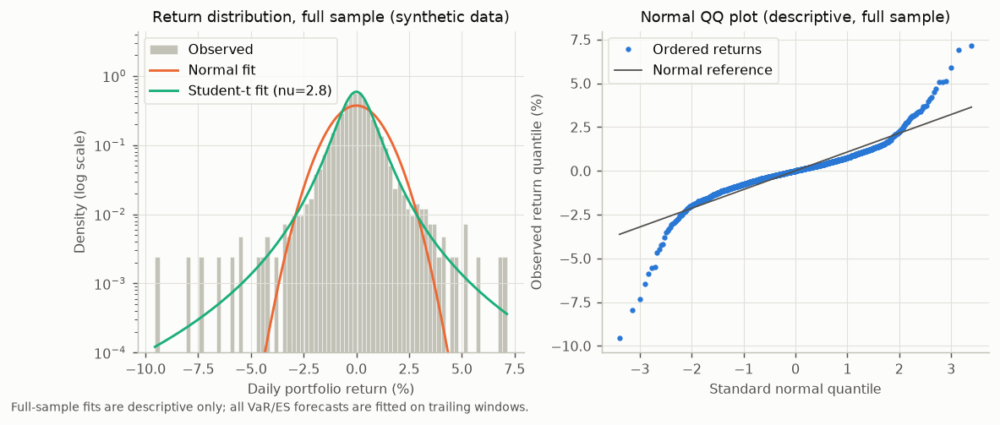
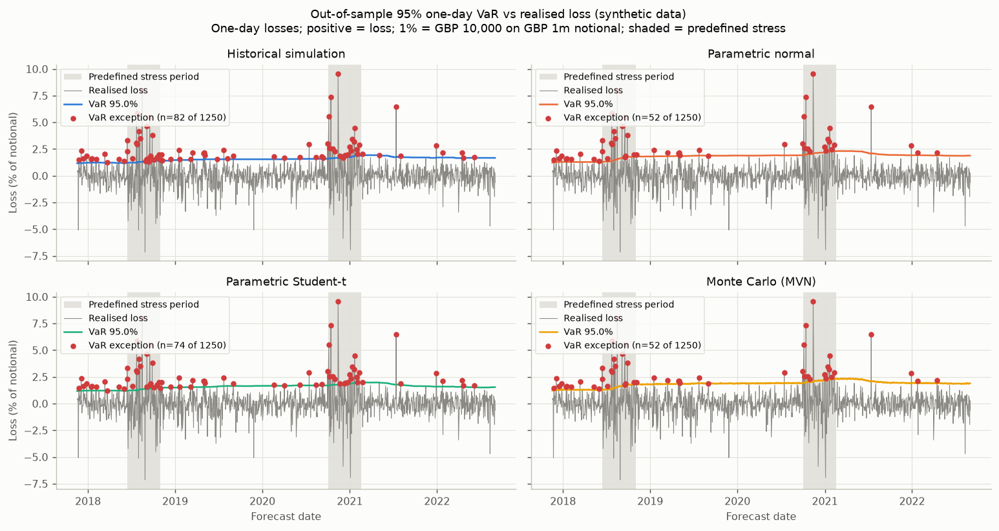
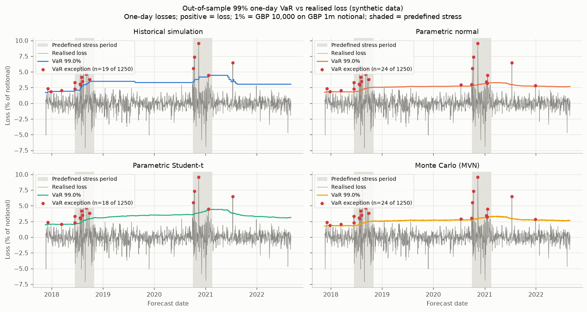
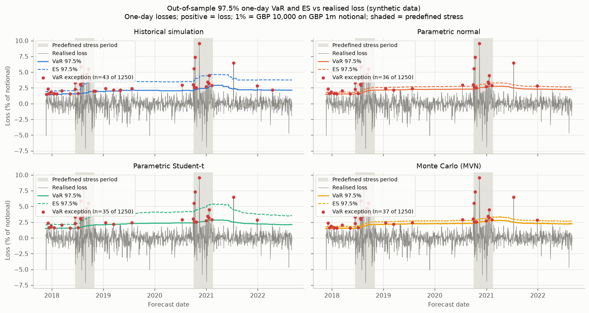
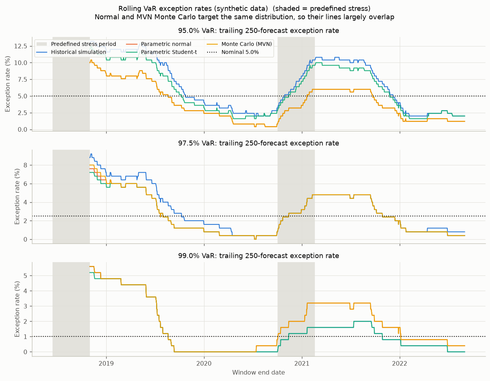
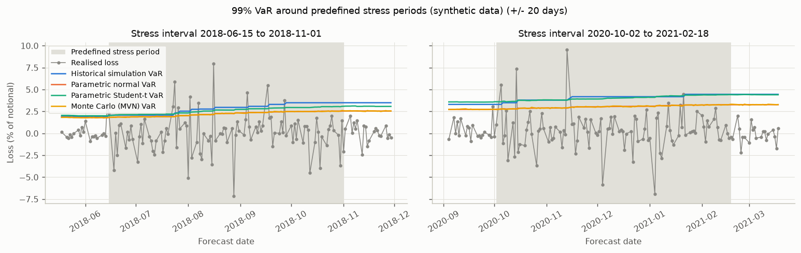
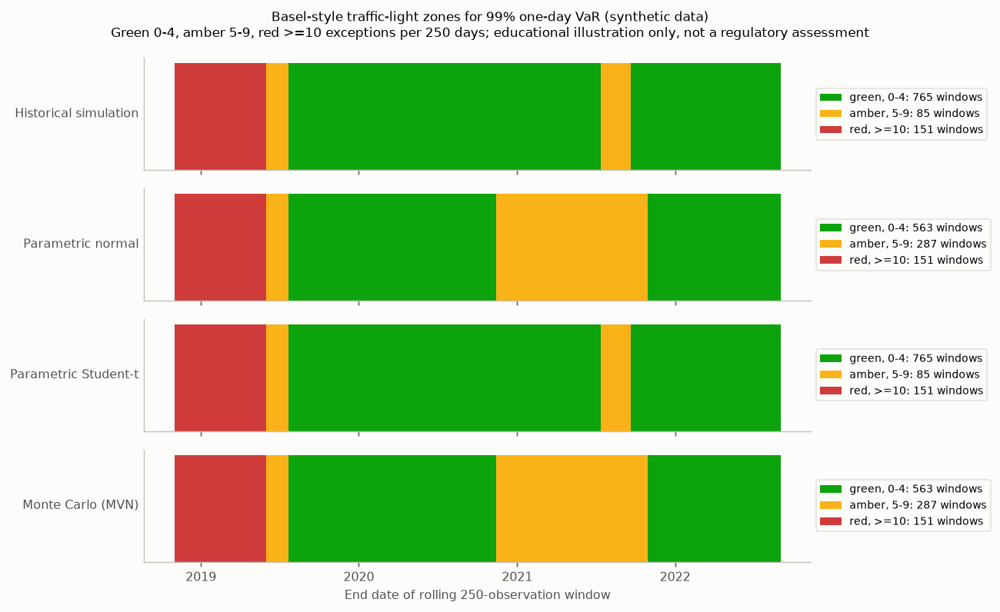
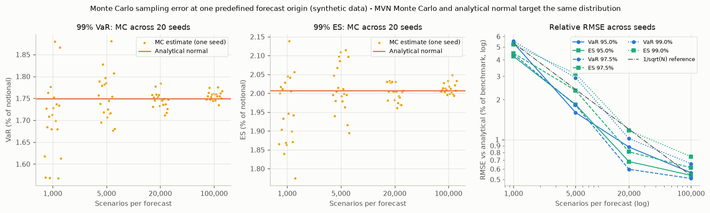

# Research report: synthetic_baseline

*Generated from saved outputs in this folder. Backtest executed (UTC): 2026-11-15T11:51:46Z. Report generated (UTC): 2026-11-15T11:51:54Z.*

> **All results below are computed on synthetic data.** They describe model behaviour under a known, stylised data-generating process and are not evidence about real equity markets.

## 1. Overview

Research question: how do historical simulation, parametric normal, parametric Student-t and correlated multivariate-normal Monte Carlo compare when forecasting one-day portfolio VaR and ES out of sample? VaR is assessed with formal coverage and independence tests; ES is assessed with the FZ0 joint VaR/ES score and descriptive calibration diagnostics (no formal ES hypothesis test).

## 2. Configuration

- Data source: `synthetic`; file `data/synthetic/asset_returns.csv` (SHA-256 `f69f2c8615c8caa1...`).
- Observations used: 2,000 (2015-01-02 to 2022-09-01); dates excluded by the complete-case policy: 0.
- Weights: Equity_A 0.30, Equity_B 0.25, Equity_C 0.20, Equity_D 0.15, Equity_E 0.10; long-only, daily rebalanced.
- Reporting notional: GBP 1,000,000 (constant-notional comparison).
- Rolling estimation window: 750 observations; refit at every origin; one-day horizon; confidence levels 95.0%, 97.5%, 99.0%.
- Monte Carlo: 20,000 scenarios per origin; master seed 20240917; per-origin seeds from SeedSequence(master, YYYYMMDD, model id).
- Forecast dates: 1,250 (2017-11-17 to 2022-09-01); common valid sample: 1,250 dates.
- Predefined stress intervals: 2018-06-15 to 2018-11-01; 2020-10-02 to 2021-02-18.

## 3. Methods (summary)

See `docs/methodology.md` for formulas. Historical simulation applies the empirical engine to the trailing window; the normal model uses the sample mean and SD (ddof=1); the Student-t model is a constrained MLE (nu in [2.01, upper bound]); Monte Carlo simulates correlated MVN asset returns from the window's mean vector and covariance. For a linear portfolio, MVN Monte Carlo and the analytical normal model target the same distribution, so their differences are sampling error.

## 4. Results

### 4.1 VaR summary (common valid sample)

| Model | Conf. | N | Exceptions | Expected | Obs. rate | Nominal | Mean VaR (GBP) | Mean ES (GBP) | Mean quantile loss | Max run |
|---|---|---|---|---|---|---|---|---|---|---|
| Historical simulation | 95.0% | 1,250 | 82 | 62.5 | 0.0656 | 0.0500 | 15,611 | 26,241 | 1.479e-03 | 3 |
| Historical simulation | 97.5% | 1,250 | 43 | 31.2 | 0.0344 | 0.0250 | 20,741 | 34,956 | 1.002e-03 | 2 |
| Historical simulation | 99.0% | 1,250 | 19 | 12.5 | 0.0152 | 0.0100 | 32,140 | 49,799 | 6.015e-04 | 2 |
| Parametric normal | 95.0% | 1,250 | 52 | 62.5 | 0.0416 | 0.0500 | 18,446 | 23,171 | 1.481e-03 | 3 |
| Parametric normal | 97.5% | 1,250 | 36 | 31.2 | 0.0288 | 0.0250 | 22,009 | 26,281 | 9.914e-04 | 2 |
| Parametric normal | 99.0% | 1,250 | 24 | 12.5 | 0.0192 | 0.0100 | 26,151 | 29,983 | 6.190e-04 | 2 |
| Parametric Student-t | 95.0% | 1,250 | 74 | 62.5 | 0.0592 | 0.0500 | 15,840 | 28,135 | 1.460e-03 | 3 |
| Parametric Student-t | 97.5% | 1,250 | 35 | 31.2 | 0.0280 | 0.0250 | 22,015 | 37,807 | 9.870e-04 | 2 |
| Parametric Student-t | 99.0% | 1,250 | 18 | 12.5 | 0.0144 | 0.0100 | 32,727 | 55,095 | 6.074e-04 | 2 |
| Monte Carlo (MVN) | 95.0% | 1,250 | 52 | 62.5 | 0.0416 | 0.0500 | 18,439 | 23,164 | 1.481e-03 | 3 |
| Monte Carlo (MVN) | 97.5% | 1,250 | 37 | 31.2 | 0.0296 | 0.0250 | 21,996 | 26,276 | 9.913e-04 | 2 |
| Monte Carlo (MVN) | 99.0% | 1,250 | 24 | 12.5 | 0.0192 | 0.0100 | 26,138 | 29,979 | 6.206e-04 | 2 |

### 4.2 VaR coverage and independence tests

| Model | Conf. | Exc. | LR_uc | p_uc | n11 | LR_ind | p_ind | IND status | LR_cc | p_cc |
|---|---|---|---|---|---|---|---|---|---|---|
| Historical simulation | 95.0% | 82 | 5.857 | 0.0155 | 6 | 0.078 | 0.7796 | ok | 5.935 | 0.0514 |
| Historical simulation | 97.5% | 43 | 4.063 | 0.0438 | 2 | 0.177 | 0.6736 | ok | 4.241 | 0.1200 |
| Historical simulation | 99.0% | 19 | 2.945 | 0.0861 | 2 | 4.641 | 0.0312 | ok | 7.586 | 0.0225 |
| Parametric normal | 95.0% | 52 | 1.965 | 0.1610 | 4 | 1.381 | 0.2400 | ok | 3.345 | 0.1877 |
| Parametric normal | 97.5% | 36 | 0.707 | 0.4006 | 2 | 0.754 | 0.3851 | ok | 1.461 | 0.4817 |
| Parametric normal | 99.0% | 24 | 8.419 | 0.0037 | 2 | 2.999 | 0.0833 | ok | 11.417 | 0.0033 |
| Parametric Student-t | 95.0% | 74 | 2.109 | 0.1465 | 6 | 0.611 | 0.4343 | ok | 2.720 | 0.2567 |
| Parametric Student-t | 97.5% | 35 | 0.445 | 0.5049 | 2 | 0.874 | 0.3498 | ok | 1.319 | 0.5171 |
| Parametric Student-t | 99.0% | 18 | 2.152 | 0.1424 | 2 | 5.045 | 0.0247 | ok | 7.196 | 0.0274 |
| Monte Carlo (MVN) | 95.0% | 52 | 1.965 | 0.1610 | 4 | 1.381 | 0.2400 | ok | 3.345 | 0.1877 |
| Monte Carlo (MVN) | 97.5% | 37 | 1.026 | 0.3112 | 2 | 0.644 | 0.4221 | ok | 1.670 | 0.4339 |
| Monte Carlo (MVN) | 99.0% | 24 | 8.419 | 0.0037 | 2 | 2.999 | 0.0833 | ok | 11.417 | 0.0033 |

Automated reading at the 5% significance level (asymptotic chi-square p-values):

- Kupiec unconditional coverage: rejected at the 5% level in 4 of 12 defined test(s): Historical simulation at 95.0%, Historical simulation at 97.5%, Parametric normal at 99.0%, Monte Carlo (MVN) at 99.0%.
- Christoffersen independence: rejected at the 5% level in 2 of 12 defined test(s): Historical simulation at 99.0%, Parametric Student-t at 99.0%.
- Christoffersen conditional coverage: rejected at the 5% level in 4 of 12 defined test(s): Historical simulation at 99.0%, Parametric normal at 99.0%, Parametric Student-t at 99.0%, Monte Carlo (MVN) at 99.0%.

Non-rejection does not prove a model correct; at 99% the expected exception count is small, so the tests have low power. Fewer exceptions than expected is not automatically better.

### 4.3 ES evaluation (joint score and descriptive diagnostics)

| Model | Conf. | FZ0 valid | FZ0 invalid | Mean FZ0 | Mean ES id. residual | SE (descr.) | Mean loss on exc. | Mean ES on exc. | Loss/ES ratio | ES<VaR |
|---|---|---|---|---|---|---|---|---|---|---|
| Historical simulation | 95.0% | 1,250 | 0 | -3.4717 | 3.36e-03 | 2.70e-03 | 0.0256 | 0.0255 | 1.006 | 0 |
| Historical simulation | 97.5% | 1,250 | 0 | -3.1429 | 5.16e-03 | 4.72e-03 | 0.0329 | 0.0311 | 1.055 | 0 |
| Historical simulation | 99.0% | 1,250 | 0 | -2.6990 | 1.04e-02 | 8.67e-03 | 0.0457 | 0.0398 | 1.147 | 0 |
| Parametric normal | 95.0% | 1,250 | 0 | -3.4526 | 6.45e-03 | 2.49e-03 | 0.0307 | 0.0216 | 1.417 | 0 |
| Parametric normal | 97.5% | 1,250 | 0 | -3.0761 | 1.34e-02 | 4.54e-03 | 0.0355 | 0.0241 | 1.472 | 0 |
| Parametric normal | 99.0% | 1,250 | 0 | -2.3349 | 3.19e-02 | 1.02e-02 | 0.0426 | 0.0275 | 1.550 | 0 |
| Parametric Student-t | 95.0% | 1,250 | 0 | -3.4895 | 1.09e-03 | 2.66e-03 | 0.0267 | 0.0270 | 0.987 | 0 |
| Parametric Student-t | 97.5% | 1,250 | 0 | -3.1685 | 1.69e-03 | 4.53e-03 | 0.0361 | 0.0341 | 1.060 | 0 |
| Parametric Student-t | 99.0% | 1,250 | 0 | -2.6974 | 5.66e-03 | 8.71e-03 | 0.0471 | 0.0437 | 1.078 | 0 |
| Monte Carlo (MVN) | 95.0% | 1,250 | 0 | -3.4516 | 6.47e-03 | 2.49e-03 | 0.0307 | 0.0216 | 1.419 | 0 |
| Monte Carlo (MVN) | 97.5% | 1,250 | 0 | -3.0750 | 1.34e-02 | 4.54e-03 | 0.0350 | 0.0240 | 1.461 | 0 |
| Monte Carlo (MVN) | 99.0% | 1,250 | 0 | -2.3256 | 3.21e-02 | 1.02e-02 | 0.0426 | 0.0274 | 1.555 | 0 |

Mean FZ0 score by confidence level, lowest (best) first. Differences have not been tested for statistical significance:

- 95.0%: Parametric Student-t (-3.4895) < Historical simulation (-3.4717) < Parametric normal (-3.4526) < Monte Carlo (MVN) (-3.4516)
- 97.5%: Parametric Student-t (-3.1685) < Historical simulation (-3.1429) < Parametric normal (-3.0761) < Monte Carlo (MVN) (-3.0750)
- 99.0%: Historical simulation (-2.6990) < Parametric Student-t (-2.6974) < Parametric normal (-2.3349) < Monte Carlo (MVN) (-2.3256)

The ES identification residual has mean zero for correctly specified continuous forecasts; positive values mean realised tail losses exceeded forecast ES on average. The SE column is a descriptive i.i.d. standard error and is not used for a formal test.

### 4.4 Stress versus non-stress periods

| Model | Conf. | Period | N | Exc. | Expected | Obs. rate | Mean VaR | Mean ES | Quantile loss | Mean FZ0 | Loss/ES on exc. |
|---|---|---|---|---|---|---|---|---|---|---|---|
| Historical simulation | 95.0% | stress | 200 | 39 | 10.0 | 0.1950 | 0.0152 | 0.0268 | 3.854e-03 | -1.4528 | 1.177 |
| Historical simulation | 95.0% | non_stress | 1,050 | 43 | 52.5 | 0.0410 | 0.0157 | 0.0261 | 1.027e-03 | -3.8562 | 0.835 |
| Historical simulation | 97.5% | stress | 200 | 22 | 5.0 | 0.1100 | 0.0208 | 0.0362 | 2.877e-03 | -0.6868 | 1.236 |
| Historical simulation | 97.5% | non_stress | 1,050 | 21 | 26.2 | 0.0200 | 0.0207 | 0.0347 | 6.454e-04 | -3.6107 | 0.831 |
| Historical simulation | 99.0% | stress | 200 | 14 | 2.0 | 0.0700 | 0.0346 | 0.0514 | 1.815e-03 | 0.2232 | 1.186 |
| Historical simulation | 99.0% | non_stress | 1,050 | 5 | 10.5 | 0.0048 | 0.0317 | 0.0495 | 3.703e-04 | -3.2556 | 1.000 |
| Parametric normal | 95.0% | stress | 200 | 27 | 10.0 | 0.1350 | 0.0186 | 0.0233 | 3.499e-03 | -1.4893 | 1.659 |
| Parametric normal | 95.0% | non_stress | 1,050 | 25 | 52.5 | 0.0238 | 0.0184 | 0.0231 | 1.096e-03 | -3.8266 | 1.123 |
| Parametric normal | 97.5% | stress | 200 | 21 | 5.0 | 0.1050 | 0.0222 | 0.0265 | 2.762e-03 | -0.0600 | 1.684 |
| Parametric normal | 97.5% | non_stress | 1,050 | 15 | 26.2 | 0.0143 | 0.0220 | 0.0262 | 6.541e-04 | -3.6506 | 1.138 |
| Parametric normal | 99.0% | stress | 200 | 16 | 2.0 | 0.0800 | 0.0263 | 0.0302 | 2.154e-03 | 3.3572 | 1.722 |
| Parametric normal | 99.0% | non_stress | 1,050 | 8 | 10.5 | 0.0076 | 0.0261 | 0.0299 | 3.266e-04 | -3.4191 | 1.182 |
| Parametric Student-t | 95.0% | stress | 200 | 36 | 10.0 | 0.1800 | 0.0159 | 0.0286 | 3.755e-03 | -1.6349 | 1.147 |
| Parametric Student-t | 95.0% | non_stress | 1,050 | 38 | 52.5 | 0.0362 | 0.0158 | 0.0281 | 1.023e-03 | -3.8427 | 0.816 |
| Parametric Student-t | 97.5% | stress | 200 | 21 | 5.0 | 0.1050 | 0.0222 | 0.0386 | 2.743e-03 | -0.9616 | 1.171 |
| Parametric Student-t | 97.5% | non_stress | 1,050 | 14 | 26.2 | 0.0133 | 0.0220 | 0.0377 | 6.526e-04 | -3.5889 | 0.860 |
| Parametric Student-t | 99.0% | stress | 200 | 14 | 2.0 | 0.0700 | 0.0332 | 0.0566 | 1.846e-03 | 0.1189 | 1.101 |
| Parametric Student-t | 99.0% | non_stress | 1,050 | 4 | 10.5 | 0.0038 | 0.0326 | 0.0548 | 3.715e-04 | -3.2338 | 0.975 |
| Monte Carlo (MVN) | 95.0% | stress | 200 | 27 | 10.0 | 0.1350 | 0.0186 | 0.0233 | 3.498e-03 | -1.4888 | 1.659 |
| Monte Carlo (MVN) | 95.0% | non_stress | 1,050 | 25 | 52.5 | 0.0238 | 0.0184 | 0.0231 | 1.097e-03 | -3.8255 | 1.127 |
| Monte Carlo (MVN) | 97.5% | stress | 200 | 21 | 5.0 | 0.1050 | 0.0221 | 0.0264 | 2.761e-03 | -0.0566 | 1.685 |
| Monte Carlo (MVN) | 97.5% | non_stress | 1,050 | 16 | 26.2 | 0.0152 | 0.0220 | 0.0262 | 6.542e-04 | -3.6499 | 1.124 |
| Monte Carlo (MVN) | 99.0% | stress | 200 | 16 | 2.0 | 0.0800 | 0.0263 | 0.0302 | 2.158e-03 | 3.3885 | 1.725 |
| Monte Carlo (MVN) | 99.0% | non_stress | 1,050 | 8 | 10.5 | 0.0076 | 0.0261 | 0.0299 | 3.278e-04 | -3.4140 | 1.189 |

Stress periods are short; rates and scores there are descriptive and no p-values are reported.

### 4.5 Basel-style traffic lights (99% VaR, educational)

| Model | Green windows | Amber windows | Red windows | Unavailable |
|---|---|---|---|---|
| Historical simulation | 765 | 85 | 151 | 0 |
| Parametric normal | 563 | 287 | 151 | 0 |
| Parametric Student-t | 765 | 85 | 151 | 0 |
| Monte Carlo (MVN) | 563 | 287 | 151 | 0 |

Zones count exceptions in overlapping 250-observation windows; they are not p-values, do not apply to ES or other confidence levels, and imply no regulatory approval or capital consequence.

### 4.6 Fit diagnostics and failures

- Historical simulation: ok = 1,250
- Monte Carlo (MVN): ok = 1,250
- Parametric normal: ok = 1,250
- Parametric Student-t: converged = 1,250
- Student-t nu: median 2.53, range 2.15 to 5.30; upper-bound hits 0, lower-bound hits 0.
- Monte Carlo covariance repairs: 0; simulated asset returns <= -100% (not clipped): 0.
- Invalid forecast rows excluded from the common sample: 0.

### 4.7 Monte Carlo convergence

Origin: forecast date 2017-11-17 (training 2015-01-02 to 2017-11-16); seeds: 20.

| Scenarios | Conf. | Seeds | Analytic VaR | Mean MC VaR | VaR RMSE | VaR mean abs. rel. error | Analytic ES | Mean MC ES | ES RMSE | ES mean abs. rel. error |
|---|---|---|---|---|---|---|---|---|---|---|
| 1,000 | 95.0% | 20 | 0.01232 | 0.01203 | 6.60e-04 | 0.0440 | 0.01550 | 0.01524 | 6.59e-04 | 0.0365 |
| 1,000 | 97.5% | 20 | 0.01472 | 0.01458 | 6.50e-04 | 0.0373 | 0.01758 | 0.01724 | 7.89e-04 | 0.0375 |
| 1,000 | 99.0% | 20 | 0.01750 | 0.01703 | 9.67e-04 | 0.0431 | 0.02007 | 0.01953 | 1.05e-03 | 0.0415 |
| 5,000 | 95.0% | 20 | 0.01232 | 0.01240 | 1.97e-04 | 0.0112 | 0.01550 | 0.01555 | 2.85e-04 | 0.0152 |
| 5,000 | 97.5% | 20 | 0.01472 | 0.01471 | 2.68e-04 | 0.0157 | 0.01758 | 0.01762 | 4.13e-04 | 0.0195 |
| 5,000 | 99.0% | 20 | 0.01750 | 0.01754 | 5.12e-04 | 0.0241 | 0.02007 | 0.02015 | 6.29e-04 | 0.0249 |
| 20,000 | 95.0% | 20 | 0.01232 | 0.01229 | 1.08e-04 | 0.0068 | 0.01550 | 0.01545 | 1.06e-04 | 0.0055 |
| 20,000 | 97.5% | 20 | 0.01472 | 0.01467 | 8.78e-05 | 0.0046 | 0.01758 | 0.01754 | 1.42e-04 | 0.0067 |
| 20,000 | 99.0% | 20 | 0.01750 | 0.01746 | 1.78e-04 | 0.0076 | 0.02007 | 0.02001 | 2.35e-04 | 0.0097 |
| 100,000 | 95.0% | 20 | 0.01232 | 0.01235 | 6.94e-05 | 0.0042 | 0.01550 | 0.01553 | 8.34e-05 | 0.0038 |
| 100,000 | 97.5% | 20 | 0.01472 | 0.01474 | 7.49e-05 | 0.0033 | 0.01758 | 0.01764 | 1.08e-04 | 0.0044 |
| 100,000 | 99.0% | 20 | 0.01750 | 0.01756 | 1.15e-04 | 0.0052 | 0.02007 | 0.02012 | 1.49e-04 | 0.0055 |

## 5. Figures

*Daily portfolio returns with predefined stress periods shaded.*

*Full-sample asset correlations (descriptive).*

*Full-sample return distribution with normal and Student-t fits (descriptive).*

*95% VaR forecasts against realised losses; exceptions marked.*

*99% VaR forecasts against realised losses; exceptions marked.*

*97.5% VaR and ES forecasts against realised losses.*

*Rolling exception rates against nominal rates.*

*99% VaR around the predefined stress periods.*

*Rolling 250-day traffic-light zones for 99% VaR (educational).*

*Monte Carlo convergence towards the analytical normal benchmark.*

## 6. Limitations

- Synthetic data: conclusions concern this stylised process only and do not establish real-market superiority.
- Unconditional rolling-window models: none of the models has conditional volatility dynamics; GARCH/FHS is out of scope.
- Overlapping estimation windows and estimation error mean the standard asymptotic test distributions are approximations.
- Low test power at 99% and in the short stress intervals.
- ES is evaluated by a joint score and descriptive diagnostics only; no formal ES backtest is implemented.
- Traffic lights are an educational simplification; no regulatory capital or compliance claim is made.
- The normal and Monte Carlo models can assign probability to returns below -100%; draws are not clipped.
